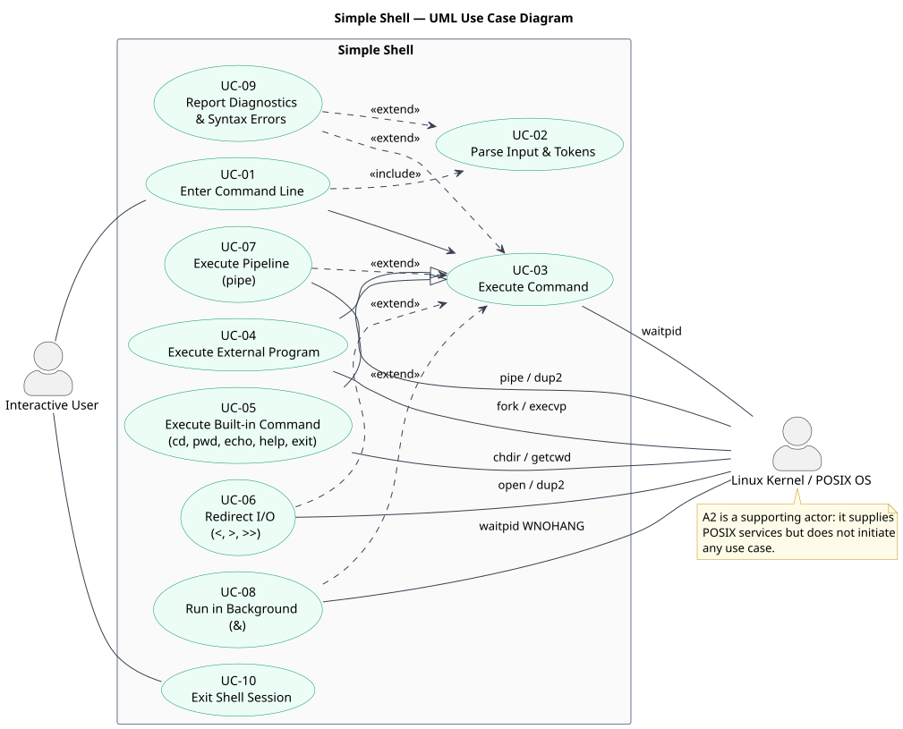

# Software Requirements Specification (SRS) — Simple Shell

| Field | Value |
|---|---|
| Document ID | H1-SRS-001 |
| Version | 2.0 |
| Date | 12 November 2026 |
| Status | Final |
| Standard | ISO/IEC/IEEE 29148:2018, following the IEEE 830 clause structure |
| Team | H1 — Simple Shell |
| Repository | https://github.com/SE-H1-SimpleShell/MiniProject_H1_SimpleShell |
| Supersedes | SRS v1.0 (Phase 1) |

## Document Control

| Version | Date | Author | Change |
|---|---|---|---|
| 1.0 | Phase 1 | Team H1 | Initial requirements baseline |
| 2.0 | 12 November 2026 | Team H1 | Restructured to ISO/IEC/IEEE 29148 clauses; security objectives and requirements added |

## 1. Introduction

### 1.1 Purpose

This document defines the functional, non-functional, and security requirements for Team H1's
Simple Shell project, and categorises them so that each requirement can be validated and traced.
It is the baseline against which the architecture, test plan, traceability matrix, and acceptance
evidence are produced.

### 1.2 Document Conventions

- **Shall** marks a mandatory requirement. **Should** marks a recommendation. **May** marks an
  optional capability.
- Every requirement has a stable identifier in one of these families: **FR-xx** (functional),
  **NFR-xx** (non-functional), **SO-xx** (security objective), **SR-xx** (security requirement).
- Requirement identifiers are never reused or renumbered. A withdrawn requirement is marked
  withdrawn rather than deleted.
- Test identifiers **TC-xx**, **NFRV-xx**, and **SEC-xx** refer to `docs/Test_Cases.md` and
  `docs/Validation_Specification.md`.
- Quantities are stated in the units used by the implementation (seconds, arguments, stages,
  bytes).

### 1.3 Intended Audience and Reading Suggestions

| Audience | Recommended reading |
|---|---|
| Course evaluator | Sections 1–4 and Appendix A |
| Developers | Sections 2.6, 3.2–3.4, 4.2 |
| Test engineers | Sections 3.2–3.4, 4.2–4.3 |
| Maintainers | Sections 2.4–2.7, 3.4, 4.4 |

### 1.4 Product Scope

The system is a lightweight Unix-like command-line interpreter for Linux. It reads commands
interactively, parses them, executes built-ins or external programs, supports basic I/O redirection
and pipelines, and reports errors.

**In scope:** interactive REPL, built-ins (`cd`, `pwd`, `echo`, `help`, `exit`), external command
execution, quoting and escaping, input/output redirection (`<`, `>`, `>>`), multi-stage pipelines
(`|`), background execution (`&`), error diagnostics, and clean termination.

**Out of scope:** full POSIX shell compliance, shell variables, glob expansion, command
substitution, aliases, scripting, and terminal job control.

### 1.5 References

| Reference | Use in this document |
|---|---|
| ISO/IEC/IEEE 29148:2018 | Requirements engineering structure and quality attributes |
| IEEE 830-1998 | SRS clause structure retained for course alignment |
| `docs/Use_Case_Catalog.md` | Use case identifiers UC-01 … UC-10 |
| `docs/RTM.md` | Requirements traceability matrix |
| `docs/Test_Cases.md` | Functional test cases and NFR verification procedures |
| `docs/Validation_Specification.md` | Security validation activities SEC-01 … SEC-06 and penetration-test plan |
| `docs/Architecture.md` | Software architecture and design description |

### 1.6 Document Overview

Section 2 describes the product, its users, constraints, and requirement categorisation.
Section 3 states the specific functional, non-functional, and security requirements.
Section 4 defines verification, traceability, and acceptance. Appendix A indexes every
requirement identifier.

## 2. Overall Description

### 2.1 Product Perspective

Simple Shell is a standalone, local, self-contained C11 program. It is not a component of a larger
system and exposes no network service. It depends only on the Linux kernel through POSIX.1-2008
interfaces (process control, signals, pipes, file descriptors, and the filesystem) and on the C
standard library.

### 2.2 Product Functions

| Function | Requirements |
|---|---|
| Interactive command entry and termination | FR-01, FR-10 |
| External command execution | FR-02, FR-09 |
| Built-in commands | FR-03 |
| Tokenisation, quoting, escaping, and operator validation | FR-04 |
| Input/output redirection | FR-05 |
| Pipelines, including built-in stages | FR-06 |
| Background execution and child reaping | FR-07, FR-09 |
| Diagnostics and safe recovery | FR-08 |

<figure class="figure">

<figcaption><strong>Figure 1 — UML use case diagram.</strong> The model has two actors: the Interactive User (A1, primary) and the Linux Kernel / POSIX OS (A2, supporting). Use case identifiers and relationship semantics are defined in <code>docs/Use_Case_Catalog.md</code>.</figcaption>
</figure>

### 2.3 User Characteristics

The primary user is a student or developer familiar with a Unix-like terminal. The user is expected
to know basic shell syntax but is not assumed to know the implementation. Error messages are
therefore written in plain language and identify the offending construct.

### 2.4 Constraints

- Linux is the official target environment.
- The implementation language is ISO C11 with POSIX.1-2008 APIs.
- The toolchain is GCC with GNU Make; the build must be warning-free under the project warning set.
- The shell is not intended to be full POSIX-shell compliant.
- Advanced job control, shell variables, glob expansion, command substitution, and scripting are
  outside the initial scope.

### 2.5 Assumptions and Dependencies

- GCC and POSIX APIs are available.
- The user has access to normal Linux executables for functional testing.
- Four team members collaborate through GitHub and Jira.
- The standard streams are attached to a terminal in interactive use; redirected input is supported
  for automated testing.

### 2.6 Requirements Categorization

Every requirement is assigned exactly one **category** and one **validation focus**. The validation
focus separates functional, security, and non-functional validation. Security is a cross-cutting
concern, not a third requirement category; security-specific identifiers are defined in Section
3.4 and mapped back to the FR/NFR baseline.

#### 2.6.1 By category

| Category | Definition | Count | Identifiers |
|---|---|---|---|
| Functional Requirement (FR) | An observable behaviour the shell must provide | 10 | FR-01 … FR-10 |
| Non-Functional Requirement (NFR) | A quality constraint on how the behaviour is delivered | 8 | NFR-01 … NFR-08 |
| **Total** | | **18** | |

#### 2.6.2 By validation focus

| ID | Category | Validation focus | Verified by |
|---|---|---|---|
| FR-01 | Functional | Functional | TC-01, TC-10 |
| FR-02 | Functional | Functional | TC-02 |
| FR-03 | Functional | Functional | TC-03, TC-04, TC-18 |
| FR-04 | Functional | Functional | TC-05, TC-06, TC-11 |
| FR-05 | Functional | Functional | TC-07, TC-08, TC-09 |
| FR-06 | Functional | Functional | TC-12 |
| FR-07 | Functional | Functional | TC-13 |
| FR-08 | Functional | Functional **and** Security | TC-11, TC-14, TC-15 |
| FR-09 | Functional | Functional | TC-16 |
| FR-10 | Functional | Functional | TC-01, TC-10 |
| NFR-01 | Non-functional | Non-functional | NFRV-01, TC-17 |
| NFR-02 | Non-functional | Non-functional | NFRV-02 |
| NFR-03 | Non-functional | Non-functional **and** Security | NFRV-03, SEC-06 |
| NFR-04 | Non-functional | Non-functional | NFRV-04 |
| NFR-05 | Non-functional | Non-functional | NFRV-05 |
| NFR-06 | Non-functional | Non-functional | NFRV-06 |
| NFR-07 | Non-functional | **Security** | NFRV-07, SEC-05 |
| NFR-08 | Non-functional | Non-functional | NFRV-08 |

#### 2.6.3 Category labels

Requirements are grouped into two categories:

- **FR** — Functional Requirements, the observable behaviour of the shell.
- **NFR** — Non-Functional Requirements, the quality constraints on that behaviour. Requirements
  referred to as VFRs are captured in this category.

Validation is deliberately **not** modelled as a third requirement category. Whether a requirement
is validated for functional behaviour, for security, or for non-functional quality is recorded as
its **validation focus** in Section 2.6.2, which keeps each requirement in exactly one category
while still separating the three validation streams.

### 2.7 Documented Implementation Limits

These limits are enforced by the parser and are part of the documented behaviour:

| Limit | Value | Behaviour when exceeded |
|---|---|---|
| Maximum arguments per command | 128 | Syntax error: `too many arguments or memory allocation failure` |
| Maximum pipeline segments | 32 | Syntax error: `pipeline is too long` |
| Multiple input redirections on one command | not supported | Syntax error: `multiple input redirections are not supported` |
| Multiple output redirections on one command | not supported | Syntax error: `multiple output redirections are not supported` |
| Multiple background operators | not supported | Syntax error: `multiple background operators are not supported` |
| `&` in a non-final position | not supported | Syntax error: `background operator must be at the end` |
| Unterminated quote | not supported | Syntax error: `unterminated quote` |
| Trailing backslash | not supported | Syntax error: `trailing escape character` |

## 3. Specific Requirements

### 3.1 External Interface Requirements

#### 3.1.1 User Interfaces

The shell presents an interactive text prompt (`simple-shell$ `) on standard error and reads command
lines from standard input. Results are written to standard output; diagnostics are written to
standard error. No graphical interface is provided.

#### 3.1.2 Hardware Interfaces

The shell runs on x86_64 Linux or a compatible Linux virtual machine/WSL2 environment. It uses the
terminal, standard streams, and filesystem supplied by the operating system; it does not access
specialised hardware.

#### 3.1.3 Software Interfaces

| Interface | Purpose |
|---|---|
| POSIX process APIs (`fork`, `execvp`, `waitpid`, `_exit`) | External command execution and child synchronisation |
| POSIX signal APIs (`sigaction`, `SIGCHLD`) | Asynchronous child notification through a self-pipe |
| POSIX I/O APIs (`open`, `read`, `write`, `dup`, `dup2`, `close`, `pipe`, `poll`) | Redirection, pipelines, and input multiplexing |
| C standard library (`malloc`, `free`, `snprintf`, `getline`) | Parsing, formatting, and memory management |
| Filesystem and environment (`chdir`, `getcwd`, `getenv`, `PATH`) | Built-in directory handling and executable lookup |

#### 3.1.4 Communication Interfaces

No network or inter-process communication protocol is exposed. Unix pipes are used internally
between pipeline stages and for SIGCHLD notification.

### 3.2 Functional Requirements

#### FR-01 — Interactive Input

The shell shall display a prompt, accept one command line at a time, and continue until `exit` or
end-of-file is received.

**Acceptance:** Given a valid command line, the shell reads it and returns to the prompt after
processing it.

#### FR-02 — External Command Execution

The shell shall execute valid external programs by creating a child process and invoking the
selected executable.

**Acceptance:** `ls`, `date`, `printf`, and similar available programs execute successfully when
invoked with valid arguments.

#### FR-03 — Built-in Commands

The shell shall support `cd`, `pwd`, `echo`, `help`, and `exit`.

**Acceptance:** Each command performs its documented operation and reports invalid arguments
appropriately.

#### FR-04 — Command Parsing

The shell shall parse whitespace-separated arguments, single- and double-quoted strings, backslash
escaping, and the supported operators `<`, `>`, `>>`, `|`, `&`.

**Acceptance:** `echo "hello world"` produces one argument containing `hello world`.

#### FR-05 — Input/Output Redirection

The shell shall support input `<`, overwrite output `>`, and append output `>>`, for both built-in
and external commands.

**Acceptance:** `echo hi > f` and `cat < f` behave as specified for built-ins and for external
programs.

#### FR-06 — Pipelines

The shell shall connect multiple commands using `|`, including pipelines in which a segment is a
built-in.

**Acceptance:** `printf "a\nb\n" | wc -l` produces the expected line count.

#### FR-07 — Background Execution

The shell shall support commands ending with `&` without waiting for completion.

**Acceptance:** `sleep 2 &` returns the prompt immediately and the process is eventually reaped.

#### FR-08 — Error Handling

The shell shall provide useful errors for invalid commands, malformed syntax, inaccessible files,
and system-call failures without terminating the shell unexpectedly.

**Acceptance:** An invalid command returns to the prompt and the shell remains usable.

#### FR-09 — Process Synchronization

The shell shall wait for foreground child processes and capture their completion status.

**Acceptance:** A foreground command does not return control to the next prompt until the command
completes.

#### FR-10 — Clean Termination

The shell shall terminate on `exit` and handle end-of-file without leaking allocated parser
resources.

**Acceptance:** Both `exit` and Ctrl-D/EOF end the interactive loop cleanly.

### 3.3 Non-Functional Requirements

#### NFR-01 — Reliability

The shell shall not crash during supported normal usage or malformed-input tests.

**Measured by:** NFRV-01 and the repeated stress runs in TC-17; the pass condition is zero crashes
and zero failing assertions across repeated `make test` runs.

#### NFR-02 — Maintainability

Parsing, built-ins, execution, and shell-loop responsibilities shall be separated into source
modules with headers.

**Measured by:** NFRV-02; each responsibility maps to one `.c` file and one `include/*.h` header.

#### NFR-03 — Memory Safety

The project shall free parser-owned heap memory and close file descriptors on normal and error
paths. Sanitizer runs shall be part of quality validation.

**Measured by:** NFRV-03 and SEC-06; AddressSanitizer and UndefinedBehaviorSanitizer shall report
zero errors and zero leaks.

#### NFR-04 — Usability

The prompt and error messages shall be consistent and understandable.

**Measured by:** NFRV-04; every diagnostic identifies the offending construct and the prompt is
restored after an error.

#### NFR-05 — Portability

The supported development target is Linux with a C11-capable GCC toolchain and POSIX APIs.

**Measured by:** NFRV-05; a clean build with `-std=c11` and the project warning flags on the target
platform.

#### NFR-06 — Testability

Every functional requirement shall map to one or more test cases in the RTM.

**Measured by:** NFRV-06 and the coverage column of `docs/RTM.md`; no FR row may have an empty test
column.

#### NFR-07 — Security Hygiene

The implementation shall avoid `system()` for external command execution and shall validate
parser/operator syntax before execution.

**Measured by:** NFRV-07 and SEC-05; a source review finds no `system(` call and malformed operator
syntax is rejected before any process or file side effect.

#### NFR-08 — Documentation

Build, installation, usage, supported syntax, documented limits, and testing instructions shall be
documented.

**Measured by:** NFRV-08; the documented syntax and limits are checked against the implementation
and the `help` output.

### 3.4 Security Requirements

The shell processes untrusted command-line input locally. Its security scope is therefore the
parser and the execution boundary: malformed input must not corrupt memory, cause uncontrolled
resource use, or be reinterpreted by a second shell layer.

#### 3.4.1 Security Objectives

| ID | Security objective | Rationale |
|---|---|---|
| **SO-01** | **Prevent command injection and unintended interpretation.** No user-supplied string shall be passed to a system shell. External programs are launched directly with an argument vector, and operator syntax is validated before execution. | The parser is the only component that handles untrusted text; a second shell layer would allow metacharacter re-entry. |
| **SO-02** | **Preserve memory and resource integrity under hostile input.** Untrusted input shall not cause memory corruption, descriptor leaks, or unbounded resource consumption; parser-owned memory and descriptors are released on every path and validated under sanitizers. | Malformed quotes, operator floods, and argument exhaustion are the main local attack surfaces. |
| **SO-03** | **Fail safely and remain available.** Invalid syntax, missing files, and system-call failures shall produce a diagnostic and leave the shell usable rather than terminating it. | The interactive loop must survive malformed input so a local user cannot accidentally or deliberately end the session through input alone. |

#### 3.4.2 Security Requirements

| ID | Security requirement | Implements | Verified by |
|---|---|---|---|
| **SR-01** | The shell shall not invoke `system()` or any other shell interpreter to run external commands. It shall use `fork()` followed by `execvp()` with an explicit NULL-terminated argument vector. | NFR-07, SO-01 | SEC-05, NFRV-07 |
| **SR-02** | The parser shall validate operator placement, duplicate redirections, and the limits in Section 2.7 before any `fork()`, file creation, or truncation. A rejected command shall produce no file or process side effects. | FR-04, FR-08, SO-01 | SEC-01, SEC-02, TC-11 |
| **SR-03** | Parser-owned heap memory and all temporary file descriptors shall be released on normal and error paths. The test suite shall pass under AddressSanitizer and UndefinedBehaviorSanitizer with no leaks or diagnostics. | NFR-03, SO-02 | SEC-06, NFRV-03 |
| **SR-04** | Invalid commands, inaccessible files, and failed `fork`, `pipe`, `exec`, or `waitpid` calls shall be reported on standard error and shall not terminate the shell. | FR-08, SO-03 | SEC-03, SEC-04, TC-14, TC-15 |

#### 3.4.3 Security Traceability and Validation

| Security objective | Security requirements | Functional/NFR baseline | Validation evidence |
|---|---|---|---|
| SO-01 | SR-01, SR-02 | NFR-07, FR-04, FR-08 | SEC-01, SEC-02, SEC-05; NFRV-07 |
| SO-02 | SR-03 | NFR-03 | SEC-06; NFRV-03 |
| SO-03 | SR-04 | FR-08 | SEC-03, SEC-04; TC-14, TC-15 |

Security validation activities are defined in `docs/Validation_Specification.md` Section 7.
Penetration-style fuzzing is planned but not executed; Section 8 of that document defines its
scope, threat model, and prohibitions. No penetration test result is claimed in this SRS.

#### 3.4.4 Relationship to Requirement Categories

Security requirements refine existing baseline requirements rather than forming a third category.
Each SR maps to one or more FR/NFR identifiers, and those baseline identifiers remain the primary
keys in `docs/RTM.md`. This preserves the single-category rule of Section 2.6 while making the
security obligations explicit and independently verifiable.

### 3.5 Design Constraints

- The implementation shall be ISO C11 with POSIX.1-2008 APIs.
- The build shall use GNU Make and GCC with strict warnings enabled.
- External programs shall be executed in child processes; built-ins that mutate parent state
  (`cd`, `exit`) shall execute in the shell process when run as a single foreground command.
- The parser shall enforce the limits in Section 2.7.

### 3.6 Other Requirements

No additional requirements beyond Sections 3.1–3.5 and the documented limits in Section 2.7.

## 4. Verification, Traceability, and Acceptance

### 4.1 Acceptance Criteria

The release is accepted when:

1. All in-scope FRs are implemented and mapped in the RTM.
2. Every FR has at least one test case and every NFR has a named verification procedure.
3. The functional, regression, and sanitizer suites pass on the agreed Linux environment.
4. The security requirements SR-01 … SR-04 have recorded validation evidence.
5. Documentation is synchronized with the implemented behaviour and documented limits.

### 4.2 Requirements Traceability

`docs/RTM.md` maps every FR to its use case, implementation module, test cases, and tracking issue,
and every NFR to its verification procedure. The security mapping is recorded in Section 3.4.3 and
in `docs/Validation_Specification.md` Section 7.

### 4.3 Verification Evidence

Recorded results are maintained in `docs/Test_Report.md` and `docs/Resource_Audit.md`. The CI
workflow `.github/workflows/ci.yml` runs the build, test suite, sanitizer suite, Valgrind target,
and repository cleanliness check on every push and pull request. Expected results shall not be
presented as observed results; any flaky or failed run is retained in the report with its
resolution.

### 4.4 Change Control

A change to an agreed requirement shall be reflected in this SRS, `docs/RTM.md`, the affected test
cases, and the architecture document in the same change set. Requirement identifiers are stable;
withdrawn requirements are marked withdrawn rather than renumbered.

## Appendix A — Requirement Index

| ID | Title | Category | Primary validation |
|---|---|---|---|
| FR-01 | Interactive Input | Functional | TC-01, TC-10 |
| FR-02 | External Command Execution | Functional | TC-02 |
| FR-03 | Built-in Commands | Functional | TC-03, TC-04, TC-18 |
| FR-04 | Command Parsing | Functional | TC-05, TC-06, TC-11 |
| FR-05 | Input/Output Redirection | Functional | TC-07, TC-08, TC-09 |
| FR-06 | Pipelines | Functional | TC-12 |
| FR-07 | Background Execution | Functional | TC-13 |
| FR-08 | Error Handling | Functional / Security | TC-11, TC-14, TC-15; SEC-03, SEC-04 |
| FR-09 | Process Synchronization | Functional | TC-16 |
| FR-10 | Clean Termination | Functional | TC-01, TC-10 |
| NFR-01 | Reliability | Non-functional | NFRV-01, TC-17 |
| NFR-02 | Maintainability | Non-functional | NFRV-02 |
| NFR-03 | Memory Safety | Non-functional / Security | NFRV-03, SEC-06 |
| NFR-04 | Usability | Non-functional | NFRV-04 |
| NFR-05 | Portability | Non-functional | NFRV-05 |
| NFR-06 | Testability | Non-functional | NFRV-06 |
| NFR-07 | Security Hygiene | Non-functional / Security | NFRV-07, SEC-05 |
| NFR-08 | Documentation | Non-functional | NFRV-08 |
| SO-01 | Prevent command injection | Security objective | SR-01, SR-02 |
| SO-02 | Preserve memory/resource integrity | Security objective | SR-03 |
| SO-03 | Fail safely and remain available | Security objective | SR-04 |
| SR-01 | Direct `execvp` execution, no `system()` | Security requirement | SEC-05, NFRV-07 |
| SR-02 | Pre-validation with no side effects | Security requirement | SEC-01, SEC-02, TC-11 |
| SR-03 | Memory and descriptor hygiene | Security requirement | SEC-06, NFRV-03 |
| SR-04 | Safe error reporting and recovery | Security requirement | SEC-03, SEC-04, TC-14, TC-15 |
