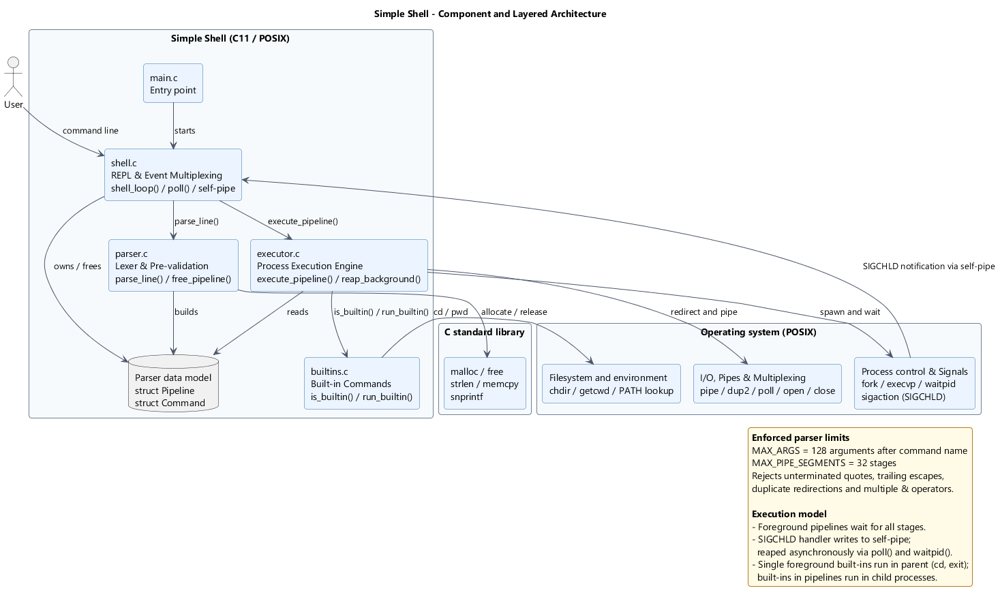
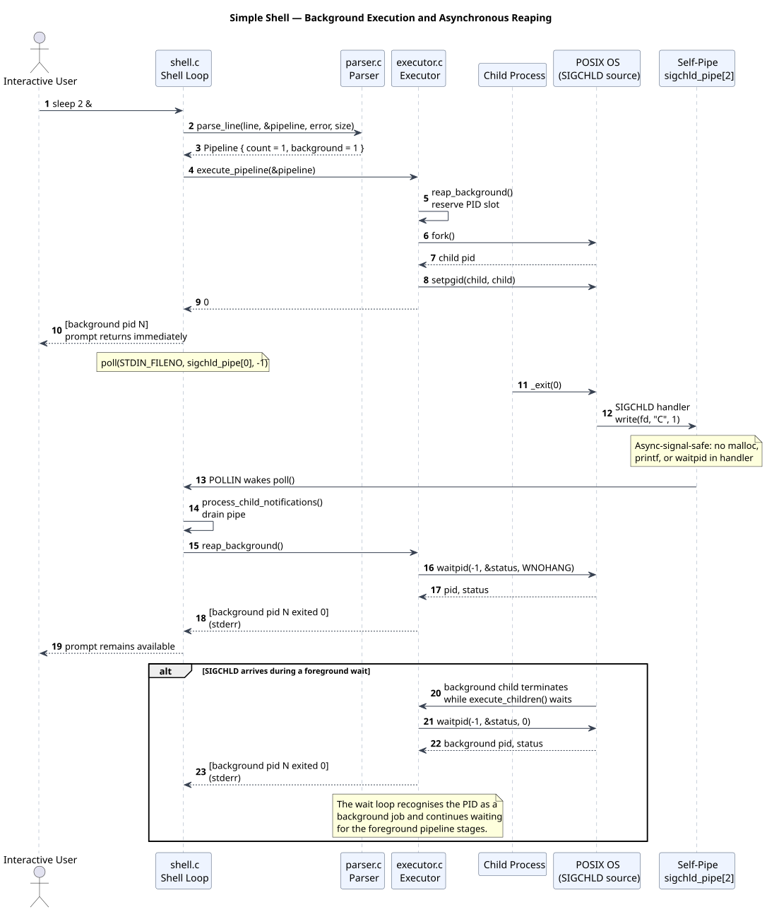

# Software Architecture and Design (SAD) — Simple Shell

| Field | Value |
|---|---|
| Document ID | H1-SAD-001 |
| Version | 2.0 |
| Date | 12 November 2026 |
| Status | Final |
| Standards | ISO/IEC/IEEE 42010:2022 (architecture description) and IEEE 1016-2009 (software design descriptions) |
| Team | H1 — Simple Shell |
| Repository | https://github.com/SE-H1-SimpleShell/MiniProject_H1_SimpleShell |
| Related documents | `docs/SRS.md`, `docs/RTM.md`, `4-Architectural-Design/Architecture_Selection.md`, `4-Architectural-Design/API_and_Component_Interfaces.md` |

> **Submission copy.** The canonical SAD is [docs/Architecture.md](../docs/Architecture.md). Keep this copy synchronized when the architecture changes.

## Document Control

| Version | Date | Author | Change |
|---|---|---|---|
| 1.0 | Phase 1 | Team H1 | Initial architecture and module design |
| 2.0 | 12 November 2026 | Team H1 | Restructured to IEEE 42010/1016; stakeholders, views, interfaces, traceability, and deviations formalized |

## 1. Introduction

### 1.1 Purpose

This document describes the architecture and detailed design of Simple Shell. It identifies the
stakeholders and their concerns, the architectural pattern and views, the component interfaces, the
runtime and process-execution design, the requirement traceability, and the deviations from the
Phase 1 design.

### 1.2 Scope

The scope covers the C11/POSIX implementation in `src/` and `include/`, the build (`Makefile`), and
the runtime behaviour of the interactive shell: prompt and input loop, parsing and validation,
built-in execution, external command execution, redirection, pipelines, background execution, and
signal-driven child reaping. Deployment tooling and network services are out of scope.

### 1.3 Intended Audience

| Audience | Recommended reading |
|---|---|
| Course evaluator | Sections 1–3, 5, and 6 |
| Developers | Sections 2.3–2.5, 3, 4 |
| Maintainers | Sections 2.5, 3.2, 4, 6 |
| Test engineers | Sections 3.2, 3.3, 5 |

### 1.4 References

| Reference | Use |
|---|---|
| `docs/SRS.md` | Requirements baseline |
| `docs/RTM.md` | Requirement-to-design and requirement-to-test traceability |
| `docs/Use_Case_Catalog.md` | Use case identifiers UC-01 … UC-10 |
| `4-Architectural-Design/Architecture_Selection.md` | Pattern alternatives and justification |
| `4-Architectural-Design/API_and_Component_Interfaces.md` | Module-level interface summary |
| `docs/Test_Report.md` | Recorded verification evidence |
| ISO/IEC/IEEE 42010:2022 | Architecture description structure |
| IEEE 1016-2009 | Software design description structure |

### 1.5 Document Conventions

- Components are named after their source module (`shell.c` → Shell Loop).
- **Shall** marks a design constraint; **should** marks a recommended choice.
- Diagrams are provided as editable PlantUML/Mermaid sources and rendered vector or raster copies
  under `4-Architectural-Design/`.
- Requirement identifiers (FR/NFR/SR) are defined in `docs/SRS.md`; use case identifiers are
  defined in `docs/Use_Case_Catalog.md`.

### 1.6 Stakeholders and Concerns

| Stakeholder | Concerns | Addressed by |
|---|---|---|
| Course evaluator | Requirements coverage, traceability, design clarity, testability | Sections 2, 4, 5; `docs/RTM.md` |
| Interactive user | Correct command behaviour, clear diagnostics, responsive prompt, predictable recovery | Sections 3.1–3.3; FR-01 … FR-10 |
| Developer / maintainer | Modularity, readable interfaces, memory safety, portability | Sections 2.3–2.5, 4.1; NFR-02, NFR-03, NFR-05 |
| Operating system / POSIX | Correct `fork`/`exec`/`wait`/`pipe`/signal use and descriptor hygiene | Sections 3.2, 3.3, 4.3; NFR-03 |
| Security reviewer | No command injection, safe failure, bounded resource use | Sections 2.5, 4.2; SR-01 … SR-04 |

## 2. Architecture Overview

### 2.1 Architectural Pattern and Rationale

Simple Shell uses a **layered, modular architecture** for a local command-line interpreter.
Responsibilities are separated into the shell loop, parser, built-in handler, execution engine, and
operating-system services. The input → parse → execute → output flow is explicit, and each layer
has a narrow header interface.

Alternatives considered in `Architecture_Selection.md`:

| Style | Decision | Reason |
|---|---|---|
| Layered / modular | Selected | Clear input → parse → execute flow; modules are independently testable and maintainable |
| Microservices | Not selected | No independent network services or deployment needs; unnecessary complexity |
| Client-server | Not selected | The shell has no remote clients, shared server state, or client/server protocol |

Two project-specific reasons for the selection:

1. Parsing and syntax validation can be tested separately from built-in handling and process
   execution.
2. Redirection, pipelines, and background execution can evolve inside execution-related modules
   while preserving the shell-loop and parser responsibilities.

### 2.2 System Context and High-Level Flow

```text
                            +-----------------------------+
                            |       User Interaction      |
                            +-----------------------------+
                                           |
                                           v
                            +-----------------------------+
                            |   shell_loop() (shell.c)    | <---+ (Self-Pipe / SIGCHLD)
                            |   poll(stdin, sigchld_pipe) |     |
                            +-----------------------------+     |
                                           |                    |
                                           v                    |
                            +-----------------------------+     |
                            |   parse_line() (parser.c)   |     |
                            | Tokenize, Validate, AST     |     |
                            +-----------------------------+     |
                                           |                    |
                                           v                    |
                           /-------------------------------\    |
                          /  Pipeline Configuration Check   \   |
                         /-----------------------------------\  |
                                    |               |           |
             Single Built-in        |               | Pipelined / External /
             (Foreground Parent)    |               | Background Command
                                    v               v
            +---------------------------+   +-------------------------------+
            | run_single_parent_builtin |   |  execute_children()           |
            | - dup() save fds          |   |  - pipe() IPC establishment   |
            | - apply_redirection()     |   |  - fork() child processes     |
            | - run_builtin() (parent)  |   |  - child_exec()               |
            | - fflush() & restore fds  |   |    * dup2() pipe & files      |
            +---------------------------+   |    * execvp() / run_builtin() |
                                            |  - waitpid() foreground       |
                                            |  - asynchronous background    |
                                            +-------------------------------+
                                                        |
                                                        v
                                        +-------------------------------+
                                        | Kernel / POSIX Process Engine |
                                        | - SIGCHLD on state change     |
                                        | - Async write('C') to pipe    |
                                        +-------------------------------+
```

The user interacts with a single process. The shell process parses input, executes state-mutating
built-ins in the parent, and delegates external commands and pipelines to child processes. The
kernel supplies process control, signals, pipes, file descriptors, and the filesystem.

### 2.3 Component Diagram



The editable PlantUML source is `4-Architectural-Design/Architecture.puml`; vector copies are
`Architecture.svg` and `Component_Diagram.svg`. The component view shows `main.c`, `shell.c`,
`parser.c`, `executor.c`, and `builtins.c` inside the shell boundary, and the C standard library
and POSIX services outside it.

The use case model is maintained as UML PlantUML at
`4-Architectural-Design/Use_Case_Diagram.puml` (rendered to `Use_Case_Diagram.svg`/`.png`) and is
embedded in `docs/SRS.md` Section 2.2.

### 2.4 Module Responsibilities

The codebase is organised into five cohesive source modules with explicit header interfaces in
`include/`:

| Module | Implementation | Header Interface | Primary Responsibility |
|---|---|---|---|
| **Entry Point** | `src/main.c` | None (`main`) | Application bootstrap; invokes `shell_loop()` and propagates the final exit code. |
| **Shell Loop & REPL** | `src/shell.c` | `include/shell.h` | Displays prompt on `stderr`, manages terminal I/O via `poll()`, configures `SIGCHLD` self-pipe notification, drains child events, dispatches pipelines, and manages REPL shutdown. |
| **Parser & AST** | `src/parser.c` | `include/parser.h` | Lexical analysis, quote preservation (`'...'`, `"..."`), escape processing (`\ `), operator pre-validation (`|`, `<`, `>`, `>>`, `&`), abstract syntax tree (`struct Pipeline`, `struct Command`) construction, and heap memory cleanup (`free_pipeline()`). |
| **Built-in Commands** | `src/builtins.c` | `include/builtins.h` | Implements internal shell commands (`cd`, `pwd`, `echo`, `help`, `exit`), directory tracking (`OLDPWD`), argument validation, and execution context branching (`in_child` vs parent). |
| **Execution Engine** | `src/executor.c` | `include/executor.h` | External program launching (`fork()`, `execvp()`), standard stream redirection (`open()`, `dup2()`), multi-stage pipeline configuration (`pipe()`), foreground synchronisation, and non-blocking zombie process harvesting (`reap_background()`). |

### 2.5 Key Architectural Decisions

1. **Local POSIX execution:** External commands use `fork()` + `execvp()`, completely avoiding
   `system()` to prevent unintended shell interpolation.
2. **Built-in execution contexts:** Solitary foreground built-ins execute in the shell parent
   process so that state changes (`cd`, `exit`) persist. Built-ins participating in pipelines
   execute within child processes (`child_exec`) to avoid mutating the parent working directory or
   terminating the parent REPL.
3. **Clean output separation:** Prompts and completion diagnostics are written to `stderr`;
   background launch messages are written to `stdout`.
4. **Real-time asynchronous reaping (self-pipe trick):** Instead of relying solely on periodic
   checks between user commands, the shell registers a `SIGCHLD` signal handler that performs an
   async-signal-safe `write()` to an internal UNIX self-pipe (`sigchld_pipe`). The interactive loop
   monitors standard input and the self-pipe simultaneously using `poll()`, immediately reaping
   finished background processes and preventing zombie accumulation even during prolonged idle
   periods.
5. **Operator pre-validation:** Syntax validation and operator bounds are validated before process
   creation or file redirection, guaranteeing that invalid commands produce zero file or process
   side effects.

### 2.6 Architectural Constraints

- Linux/POSIX.1-2008 is the target platform; the code is ISO C11.
- External commands execute in child processes; single foreground built-ins that mutate parent
  state execute in the shell process.
- The parser enforces `MAX_ARGS = 128` and `MAX_PIPE_SEGMENTS = 32`.
- No network service, database, or external runtime dependency is introduced.

## 3. Architectural Views

### 3.1 Component-and-Connector View

| Connector | From → To | Contract |
|---|---|---|
| Command line input | User → Shell Loop | A line of text on standard input |
| Parse request | Shell Loop → Parser | `parse_line(line, pipeline, error, error_size)` |
| Execution request | Shell Loop → Executor | `execute_pipeline(pipeline)` |
| Built-in dispatch | Executor → Built-ins | `is_builtin(name)`, `run_builtin(cmd, in_child)` |
| Process and I/O services | Executor → POSIX | `fork`, `execvp`, `pipe`, `dup2`, `waitpid`, `open`, `close` |
| Child notification | Kernel → Shell Loop | `SIGCHLD` → `write()` to self-pipe → `poll()` wake-up |

The shell loop owns the parser output and frees it with `free_pipeline()` after every iteration.
The executor treats the pipeline as read-only input. This prevents shared mutable state between
components.

### 3.2 Runtime View — Asynchronous Background Reaping and Self-Pipe

A critical architectural enhancement in Simple Shell is its real-time, asynchronous background
process reaping mechanism, implemented via the **self-pipe trick**:

#### A. The signal-handling limitation

In standard POSIX programming, invoking non-async-signal-safe functions (such as `printf()`,
`malloc()`, `fflush()`, or complex state updates) inside a signal handler leads to undefined
behaviour, reentrancy deadlocks, and corrupted shell state. Conversely, relying solely on periodic
reaping between command prompts leaves background processes as "zombie" processes until the user
presses Enter, failing to provide immediate completion feedback during long idle periods.

#### B. The self-pipe solution

Simple Shell resolves this using a dedicated unidirectional UNIX pipe (`sigchld_pipe[2]`)
configured as follows:

1. **Pipe initialisation:** During startup (`initialize_child_notifications`), the shell opens
   `sigchld_pipe` and sets both read and write descriptors to non-blocking (`O_NONBLOCK`) and
   close-on-exec (`FD_CLOEXEC`).
2. **Signal handler:** A POSIX signal handler (`handle_sigchld`) is registered for `SIGCHLD` via
   `sigaction()`. When any child process terminates, stops, or continues, the kernel delivers
   `SIGCHLD`. The handler executes only a single, async-signal-safe system call:
   ```c
   const char notification = 'C';
   (void)write(fd, &notification, sizeof(notification));
   ```
   No formatting, memory allocations, or `waitpid()` calls occur inside the signal context.
3. **I/O multiplexing via `poll()`:** The interactive input reader (`read_command_line`) monitors
   two file descriptors simultaneously:
   - `descriptors[0].fd = STDIN_FILENO` (`POLLIN`)
   - `descriptors[1].fd = sigchld_pipe[0]` (`POLLIN`)
4. **Draining in normal execution context:** When `poll()` detects activity on `descriptors[1]`,
   the shell invokes `process_child_notifications()`. This drains all accumulated notification
   bytes from the pipe and calls `reap_background()`.
5. **Non-blocking zombie harvesting:** `reap_background()` executes a loop around
   `waitpid(-1, &status, WNOHANG)`:
   - Reaps all terminated background children.
   - Emits asynchronous diagnostic messages to `stderr` (e.g. `[background pid 12345 exited 0]`).
   - Prevents zombie process accumulation.
6. **Idle detection:** A self-pipe notification wakes `poll()`, allowing completed background
   processes to be reaped while the user is idle at the prompt. Handling occurs when the shell is
   scheduled; it is not a real-time latency guarantee.
7. **Foreground concurrency reaping:** If a background child finishes while the shell is blocked in
   `execute_children()` waiting for foreground pipeline stages, the `waitpid(-1, &status, 0)` loop
   detects that the reaped PID belongs to a background job, prints its termination message to
   `stderr`, and continues waiting for the foreground pipeline stages without interruption.

### 3.3 Process Execution View

#### Solitary foreground built-in commands

Commands that mutate parent shell state (`cd`, `exit`) or inspect current state (`pwd`, `echo`,
`help`) run directly within the parent process when executed as a single foreground command:

- Standard input/output are backed up using `dup()`.
- Redirections (`<`, `>`, `>>`) are applied using `apply_redirection()`.
- On redirection failure, saved descriptors are restored, and built-in execution is inhibited.
- `run_builtin(cmd, 0)` executes the command logic.
- Output buffer is committed with `fflush(stdout)`.
- Standard streams are restored via `dup2()` and the duplicate descriptors are closed.

#### Pipelines and external commands

Pipelines (`count >= 2`) or external commands execute in child processes spawned via `fork()`:

- **Pipes:** Consecutive command stages `i` and `i+1` are linked via `pipe(pipe_fd)`. The read-end
  of the previous stage (`previous_read`) supplies `STDIN_FILENO`, and the write-end of the
  current pipe (`pipe_fd[1]`) supplies `STDOUT_FILENO`.
- **Descriptor hygiene:** Unused pipe ends are closed immediately in both child and parent
  processes. Intermediate file descriptors are closed as stages are launched, preventing file
  descriptor leaks and guaranteeing that EOF propagates cleanly to consumers.
- **Redirection precedence:** In `child_exec()`, pipeline descriptors are duplicated first,
  followed by explicit command file redirections (`cmd->input_file`, `cmd->output_file`). File
  redirections override pipeline descriptors if both are specified.
- **Built-ins in pipelines:** Built-in commands within pipelines execute in child processes
  (`run_builtin(cmd, 1)`), terminating with `_exit()`. This ensures that `cd` or `exit` inside a
  pipeline segment (e.g. `cd /tmp | cat` or `exit | cat`) does not alter the parent shell's
  working directory or terminate the parent REPL.
- **Foreground synchronisation:** The parent waits for all foreground child processes using
  `waitpid()`. The exit status of the rightmost command stage is returned as the pipeline result.
- **Background execution:** If `pipeline->background` is set (`cmd &`), the parent prints
  `[background pid <pid>]` to `stdout`, flushes `stdout`, and returns `0` immediately without
  blocking.

### 3.4 Data View

The parser produces one `struct Pipeline` per command line:

| Structure | Fields | Ownership |
|---|---|---|
| `struct Command` | `char *argv[MAX_ARGS + 2]`, `size_t argc`, `char *input_file`, `char *output_file`, `int append_output` | Dynamically allocated strings owned by the command; released by `free_pipeline()` |
| `struct Pipeline` | `struct Command commands[MAX_PIPE_SEGMENTS]`, `size_t count`, `int background` | Owned by the shell loop for the duration of one REPL iteration |

The structures are defined in `include/parser.h`. The shell loop allocates no separate AST nodes:
the pipeline is a stack value whose heap members are released after execution.

### 3.5 Deployment View

Simple Shell is deployed as a single statically linked-by-default executable (`simple-shell`)
built from the five source modules. It runs in a Linux terminal as the current user's process. No
server, database, container, or network listener is required. Development and CI use Ubuntu Linux
with GCC and GNU Make.

### 3.6 Security Architecture View

The security architecture follows the threat model in `docs/Validation_Specification.md` Section 8:
the parser is the primary attack surface, and the executor is the secondary boundary that forwards
validated tokens to POSIX process APIs.

#### 3.6.1 Trust boundaries

| Boundary | Untrusted side | Trusted side | Control |
|---|---|---|---|
| **B1 — Input → Parser** | Raw command-line text | Parser | Lexical validation, quote/escape handling, operator grammar, and documented limits are checked before the AST is accepted (SR-02). |
| **B2 — Parser → Executor** | Parsed `struct Pipeline` | Executor | Only validated tokens and file paths cross the boundary; no command string is passed to a shell (SR-01). |
| **B3 — Child → Parent** | Child process behaviour | Shell loop | The parent relies on the child's exit status and never interprets child output as control input. |
| **B4 — Signal → Normal context** | Asynchronous `SIGCHLD` | Normal execution context | The handler performs one async-signal-safe `write()`; all allocation, formatting, and `waitpid()` work happens in `poll()`/normal context. |

#### 3.6.2 Assets and threats

| Asset | Threat | Control |
|---|---|---|
| Shell process integrity | Malformed input causing memory corruption or a crash | Parser bounds and allocation checks; `free_pipeline()` on every path; ASan/UBSan in CI (SR-03) |
| User files and redirection targets | A rejected command still creating or truncating a file | Operator pre-validation before `open()`/`O_TRUNC` (SR-02) |
| Child processes and pipeline stages | Leaked children, zombies, or partial pipelines after a failure | `waitpid()` and `reap_background()`; `reap_spawned_children()` on partial pipeline teardown |
| Terminal and file descriptors | Descriptor leaks or accidental descriptor inheritance | `FD_CLOEXEC`, immediate close of unused pipe ends, saved/restored parent descriptors (SR-03) |
| Execution boundary | Command injection or metacharacter re-entry | No `system()`, no `popen()`, direct `execvp()` with an argv array (SR-01) |
| Shell availability | Malformed input, missing files, or failed syscalls terminating the REPL | Diagnostics plus recovery in the shell loop (SR-04) |

#### 3.6.3 Security controls and design principles

| Control | Implementation | Requirement | Evidence |
|---|---|---|---|
| Validate before use | Parser rejects malformed operators, duplicate redirections, and limit violations before execution | SR-02 | TC-11, SEC-01, SEC-02 |
| Direct execution | `fork()` + `execvp()`; no `system()` or implicit shell layer | SR-01 | SEC-05, NFRV-07 |
| Memory and descriptor hygiene | `free_pipeline()`; descriptor save/restore; close-on-exec; sanitizer targets | SR-03 | NFRV-03, SEC-06 |
| Safe failure | Errors reported to `stderr`; the parent loop continues | SR-04 | TC-14, TC-15, SEC-03, SEC-04 |
| Bounded resources | `MAX_ARGS = 128`, `MAX_PIPE_SEGMENTS = 32`, background PID cap | SR-02 | SEC-02 |
| Safe signal handling | Self-pipe handler writes one byte; reaping in normal context | SR-04 | TC-13, background reaping tests |
| Least privilege | The shell runs as the invoking user and does not setuid, install capabilities, or require elevated privileges | SR-01 | Deployment model |
| Minimal attack surface | No network listener, no dynamic code loading, no configuration language, no plugins | SR-01 | Component view |

The design applies **validate-before-use**, **fail closed on parse**, **least privilege**,
**minimise attack surface**, **defence in depth** (parser validation plus executor isolation plus
sanitizer evidence), **safe signal handling**, and **no dynamic code execution**.

#### 3.6.4 Residual risks and limitations

- The shell executes arbitrary programs requested by the user; this is its purpose, not a sandbox.
- There is no privilege separation, `seccomp` filter, namespace isolation, or resource limit beyond
  the parser limits and background-process cap.
- A local user who can already run programs is trusted; the security scope is safe parsing and
  execution, not multi-tenant isolation.
- Penetration-style fuzzing is planned but not executed (`docs/Validation_Specification.md`
  Section 8), and system-call fault injection remains a known test gap (`docs/RTM.md` Section 4).

## 4. Detailed Design

### 4.1 API and Component Interfaces

The architecture defines four primary C interfaces:

#### `include/shell.h`

- `int shell_loop(void)`: Main REPL entry point. Repeatedly presents the prompt, polls input and
  notifications, parses commands, executes pipelines, and shuts down cleanly.

#### `include/parser.h`

- `#define MAX_ARGS 128`: Maximum arguments after the command name (129 total `argv` entries,
  excluding the NULL terminator).
- `#define MAX_PIPE_SEGMENTS 32`: Maximum supported pipeline command stages.
- `int parse_line(const char *line, struct Pipeline *pipeline, char *error, size_t error_size)`:
  Tokenises the line, processes quotes/escapes, validates operator grammar, and populates the AST.
- `void free_pipeline(struct Pipeline *pipeline)`: Frees all dynamic memory in a pipeline (argv
  strings, redirection paths).

#### `include/builtins.h`

- `int is_builtin(const char *name)`: Checks whether a string matches `cd`, `pwd`, `echo`, `help`,
  or `exit`.
- `int run_builtin(const struct Command *cmd, int in_child)`: Executes built-in logic with context
  awareness.
- `#define SHELL_STATUS_EXIT 1000`: Sentinel status signalling parent loop termination.

#### `include/executor.h`

- `int execute_pipeline(const struct Pipeline *pipeline)`: Dispatches a single built-in or
  multi-stage children.
- `void reap_background(void)`: Harvests finished background children via non-blocking `waitpid()`.

The interface summary is maintained in `4-Architectural-Design/API_and_Component_Interfaces.md`.

### 4.2 Command Parsing and Validation Design

`parse_line()` performs a single left-to-right pass with these responsibilities:

1. Split input on unquoted whitespace while preserving quoted spans and backslash escapes.
2. Recognise the operators `<`, `>`, `>>`, `|`, and `&` only when unquoted.
3. Reject malformed combinations before returning: duplicate input/output redirections, multiple
   background operators, a non-final `&`, unterminated quotes, a trailing escape, more than 128
   arguments, or more than 32 pipeline stages.
4. Populate `struct Pipeline` only after validation succeeds; on failure, write a diagnostic to the
   caller's error buffer and free any partially allocated tokens.

This design enforces SR-02: no `fork()`, file creation, or truncation occurs for a rejected
command.

### 4.3 Execution Design

Execution branches on the parsed pipeline:

| Input shape | Execution path | State effects |
|---|---|---|
| Single built-in, foreground | `run_single_parent_builtin()` in the shell process | `cd` and `exit` persist; descriptors are saved and restored around redirections |
| External command, foreground | `execute_children()` with one child, then `waitpid()` | Child state only; parent waits and records status |
| Pipeline (2–32 stages) | `execute_children()` with `pipe()`/`dup2()` between stages, then wait for all | Each stage is isolated; the rightmost status is the pipeline result |
| Background command | `execute_children()` without blocking; launch message to `stdout` | Prompt returns immediately; SIGCHLD self-pipe drives later reaping |

### 4.4 Sequence Diagrams

#### 4.4.1 Foreground command execution


The foreground sequence shows the interaction for a single command: the user enters a line, the
shell loop reads it, the parser tokenises and validates it, the executor forks a child (or runs a
built-in in the parent), the OS performs the process or file operation, the child exits, and the
parent waits and redisplays the prompt.

#### 4.4.2 Background execution and asynchronous reaping



The background sequence shows how a trailing `&` returns the prompt immediately. The child is
registered in the background PID table, the shell loop blocks in `poll()` on standard input and
the self-pipe, and the `SIGCHLD` handler writes a single notification byte. `poll()` wakes,
`process_child_notifications()` drains the pipe, and `reap_background()` calls `waitpid(-1, ...,
WNOHANG)` to harvest the child and emit `[background pid N exited M]` on `stderr`. The lower
fragment shows the concurrent case: a background child that finishes while the shell is blocked
waiting for a foreground pipeline is still detected and reaped.

### 4.5 Error Handling and Recovery Protocols

#### 4.5.1 Protocol rules

| Rule | Requirement |
|---|---|
| **P1 — Validate before side effects:** syntax and limit failures are reported before any `fork()`, `open()`, or `O_TRUNC`, so a rejected command cannot create or destroy files. | SR-02 |
| **P2 — The shell survives command failure:** an error in a command never terminates the interactive loop; the prompt is restored. | SR-04 |
| **P3 — Child failures are encoded in the exit status:** the child reports a failure through `_exit()`; the parent does not parse child output for control flow. | FR-08, FR-09 |
| **P4 — Partial pipeline teardown:** if a later `pipe()` or `fork()` fails, already-created descriptors are closed and already-spawned children are reaped before returning. | FR-08, NFR-03 |
| **P5 — Parent descriptor restoration:** a parent-executed built-in saves `stdin`/`stdout` with `dup()`, applies redirection, and restores the saved descriptors on success and failure. | FR-03, FR-05 |
| **P6 — Memory release on every iteration:** `free_pipeline()` is called after normal execution, parse failure, empty input, and termination. | FR-10, SR-03 |
| **P7 — Retry on `EINTR`:** `read`, `poll`, and `waitpid` loops retry when interrupted by a signal. | FR-09 |
| **P8 — Async-signal-safe notification:** the `SIGCHLD` handler only writes one byte to the self-pipe; all reaping occurs in normal context. | SR-04 |

#### 4.5.2 Error classes and recovery actions

| Error class | Detection | Diagnostic | Recovery | Status |
|---|---|---|---|---|
| Malformed syntax, unterminated quote, trailing escape, duplicate redirection, limit exceeded | `parse_line()` returns non-zero | `shell: syntax error: <message>` on `stderr` | Partially allocated tokens are freed; the shell loop continues | Shell remains usable |
| Memory allocation failure | `malloc`/`strdup` returns `NULL` | `memory allocation failure` in the parser error buffer | Partial structures are released; command is not executed | Shell remains usable |
| Parent built-in input redirection failure | `open()` or `dup2()` returns `-1` | `shell: cannot open <file>: <errno>` or `shell: dup2: <errno>` | Saved descriptors are restored; the built-in is not executed | Command fails |
| Child redirection failure | `open()` or `dup2()` returns `-1` in `child_exec()` | `shell: cannot open <file>: <errno>` or `shell: dup2 <stream>: <errno>` | Child calls `_exit(126)` | Exit status 126 |
| `pipe()` failure | `pipe()` returns non-zero | `shell: pipe: <errno>` | Previous read descriptor is closed; spawned children are reaped | Current pipeline fails, shell continues |
| `fork()` failure | `fork()` returns `-1` | `shell: fork: <errno>` | Pipe descriptors are closed; spawned children are reaped | Current pipeline fails, shell continues |
| `execvp()` failure | `execvp()` returns | `shell: <command>: <errno>` | Child calls `_exit(127)` for `ENOENT`, `_exit(126)` otherwise | Exit status 127 or 126 |
| `waitpid()` interrupted | `errno == EINTR` | No diagnostic | Retry the wait | Wait continues |
| `waitpid()` other failure | `errno != ECHILD` | `shell: waitpid(<pid>): <errno>` | Report and continue | Shell remains usable |
| Background capacity exhausted | Background count exceeds the PID table | `shell: too many background processes` | Command is rejected before spawning | Shell remains usable |
| End of input | `read` returns 0 | Newline on `stderr` | Loop breaks; pipeline storage is released | Clean exit |
| `SIGTERM` requested | Termination flag set by the signal handler | Cleanup message | Children are reaped; the loop exits | 128 + `SIGTERM` (143) |

#### 4.5.3 Reporting conventions

All diagnostics use the `shell: ` prefix and, where a system call failed, `strerror(errno)`. The
parent shell never calls `exit()` from an error path; only the normal loop termination path sets
the process exit status. Child processes use `_exit()` so that buffered parent state is not
duplicated.

#### 4.5.4 Known limitations

System-call fault injection is not part of the automated suite, so `fork`, `pipe`, `exec`, and
`waitpid` failure paths are reviewed rather than exercised by a fault-injection harness. This is
recorded in `docs/RTM.md` Section 4.

## 5. Architecture Traceability

### 5.1 Requirements-to-Architecture Mapping

| Requirement | Primary components | Design element |
|---|---|---|
| FR-01 Interactive input | `shell.c` | `shell_loop()`, `read_command_line()`, `poll()` |
| FR-02 External execution | `executor.c` | `execute_children()`, `child_exec()`, `execvp()` |
| FR-03 Built-in commands | `builtins.c`, `executor.c` | `is_builtin()`, `run_builtin()`, parent/child branching |
| FR-04 Command parsing | `parser.c` | Lexer, quote/escape handling, operator validation |
| FR-05 I/O redirection | `parser.c`, `executor.c` | `input_file`/`output_file`, `apply_redirection()`, `dup2()` |
| FR-06 Pipelines | `parser.c`, `executor.c` | `struct Pipeline`, `pipe()`, stage loop, descriptor hygiene |
| FR-07 Background execution | `shell.c`, `parser.c`, `executor.c` | `background` flag, `reap_background()`, self-pipe |
| FR-08 Error handling | `shell.c`, `parser.c`, `executor.c`, `builtins.c` | Error buffer, diagnostics, safe recovery |
| FR-09 Process synchronisation | `executor.c` | `waitpid()`, foreground wait loop |
| FR-10 Clean termination | `shell.c`, `builtins.c` | `SHELL_STATUS_EXIT`, `free_pipeline()`, EOF handling |
| NFR-02 Maintainability | All modules | Five modules with headers and narrow interfaces |
| NFR-03 Memory safety | `parser.c`, `executor.c` | `free_pipeline()`, descriptor cleanup, sanitizer targets |
| NFR-05 Portability | Build and all modules | C11/POSIX with strict GCC flags |
| NFR-07 Security hygiene | `parser.c`, `executor.c` | Pre-validation, `execvp()` without `system()` |
| SR-01 … SR-04 | `parser.c`, `executor.c`, `shell.c` | Validation boundary, error paths, sanitizer audit |

### 5.2 Use Case-to-Component Mapping

| Use case | Component |
|---|---|
| UC-01 Enter Command Line, UC-10 Exit Shell Session | `shell.c` |
| UC-02 Parse Input & Tokens | `parser.c` |
| UC-03 Execute Command, UC-04 Execute External Program | `executor.c` |
| UC-05 Execute Built-in Command | `builtins.c`, `executor.c` |
| UC-06 Redirect I/O, UC-07 Execute Pipeline, UC-08 Run in Background | `parser.c`, `executor.c` |
| UC-09 Report Diagnostics & Syntax Errors | `shell.c`, `parser.c`, `executor.c` |

## 6. Deviations from Phase 1 SRS/SAD

During Sprint 1 and Sprint 2 implementation and quality hardening, several architectural
refinements were introduced to resolve POSIX edge cases, enhance concurrency, prevent resource
leaks, and eliminate zombie process accumulation.

The table below catalogues all deviations between the Phase 1 architectural design/SRS expectations
and the final merged implementation on `main`:

| Area | Phase 1 Design / Expectation | Actual Merged Implementation | Rationale and Engineering Impact | Status |
|---|---|---|---|---|
| **Input Loop & Event Multiplexing** | Standard blocking `getline(3)` or stream read on `stdin`. | `read_command_line()` using `poll()` on `STDIN_FILENO` and a self-pipe descriptor (`sigchld_pipe[0]`), reading characters into an expanding dynamic buffer. | **Architectural Refinement:** Allows the shell to be multiplexed between terminal user input and background child state changes. Eliminates blocking deadlocks and enables prompt wakeups when background tasks finish. | Implemented & verified (PR #28). FR-01 and FR-07 satisfied. |
| **Background Child Reaping** | Periodic reaping between prompts using `waitpid(-1, &status, WNOHANG)`. | Real-time asynchronous `SIGCHLD` handler writing to a non-blocking self-pipe, drained by `poll()` and reaped via `reap_background()`; concurrent reaping during foreground waits. | **Architectural Hardening:** Periodic-only reaping left zombie processes in the OS process table if the user remained idle at the prompt. The self-pipe trick ensures immediate zombie cleanup and instant feedback on `stderr` without risking signal-safety violations. | Implemented & verified (PR #28). FR-07 enhanced. |
| **Pipeline Scale & Capacity** | Two-stage pipelines (`cmd1 \| cmd2`) illustrated in early design diagrams and test cases (TC-12). | Generic multi-stage pipeline executor supporting up to 32 concurrent stages (`MAX_PIPE_SEGMENTS = 32`). | **Capability Extension:** Extended from two stages to arbitrary pipelines up to 32 stages. Concurrent child execution and immediate closing of unused pipe ends prevents pipe buffer exhaustion and deadlocks on large data transfers (`seq 20000 \| wc -l`). | Implemented & verified (PR #27). FR-06 expanded. |
| **Built-in Execution Isolation** | Initial high-level design described built-ins as executing within the shell process without distinguishing pipeline context. | Context-aware execution: a single foreground built-in executes in the parent (persisting `cd`/`exit`); built-ins in pipelines or background execute in child processes via `run_builtin(cmd, 1)` and `_exit()`. | **Architectural Refinement:** Conforms to POSIX pipeline isolation standards. Prevents child stages (e.g. `cd /tmp \| cat`) from inadvertently mutating the parent working directory or terminating the parent interactive shell. | Implemented & verified (PR #27). FR-03 & FR-06 isolated. |
| **Operator Pre-Validation** | Lexical parsing during AST construction, with syntax errors and redirection handling deferred to execution time. | Strict pre-validation pass in `src/parser.c` verifying operator counts (`&&`, duplicate `<`/`>`, misplaced `&`, boundary limits) before execution. | **Security & Robustness Hardening:** Satisfies NFR-07 (security hygiene). Rejection of malformed syntax occurs before any child processes are forked or any output files are truncated/created (`touch must-not-exist \| cat > rejected > duplicate` is rejected before any files are created). | Implemented & verified (PR #27). FR-04 & FR-08 hardened. |

### Summary of Deviation Impact

None of the architectural deviations represents an abandonment or compromise of original
requirements. Instead, all five deviations represent **engineering refinements and hardening**
beyond the initial design sketches, using POSIX process and I/O APIs while preserving the limited
shell syntax documented in the README. Full POSIX shell language compliance is not claimed;
resource audit and regression acceptance were tracked and closed in issues #15 and #16.
