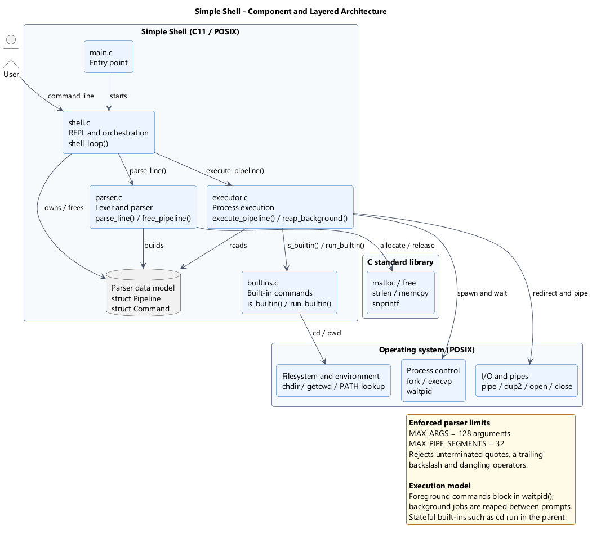

# Architecture and Design — Simple Shell



The editable PlantUML source is [Architecture.puml](Architecture.puml); a vector copy is
[Architecture.svg](Architecture.svg). See the [folder README](README.md#regenerating-the-plantuml-diagram)
for regeneration instructions. *(Note: PlantUML is not installed in the local environment, so the editable diagram source has been updated to reflect the self-pipe SIGCHLD architecture without regenerating raster artifacts).*

Canonical architecture documentation and deviation logs are maintained in [docs/Architecture.md](../docs/Architecture.md).

## High-level flow

```text
User
  |
  v
Shell Loop (shell.c) <---+ (SIGCHLD / Self-pipe notification)
  |                      |
  +--> poll(stdin, pipe) |
  |                      |
  v                      |
Lexer / Pre-validator (parser.c)
  |
  +--> Solitary Built-in in parent (foreground single command: cd, pwd, echo, help, exit)
  |
  +--> Process Executor (executor.c)
          |
          +--> fork/execvp
          +--> I/O redirection (open/dup2)
          +--> multi-stage pipelines up to 32 stages (pipe/dup2)
          +--> child built-in execution within pipeline stages
          +--> waitpid for foreground child processes
          +--> asynchronous reap for background children via SIGCHLD self-pipe
```

## Module responsibilities

| Module | Implementation | Header Interface | Responsibility |
|---|---|---|---|
| `main.c` | `src/main.c` | None (`main`) | Entry point; launches the interactive shell loop. |
| `shell.c` | `src/shell.c` | `include/shell.h` | Prompt display (`stderr`), input multiplexing with `poll()`, `SIGCHLD` self-pipe registration, child notification processing, and clean termination. |
| `parser.c` | `src/parser.c` | `include/parser.h` | Lexer, quote/escape handling, operator pre-validation (`|`, `<`, `>`, `>>`, `&`), AST construction, and heap memory cleanup (`free_pipeline()`). |
| `builtins.c` | `src/builtins.c` | `include/builtins.h` | Built-in semantics (`cd`, `pwd`, `echo`, `help`, `exit`), OLDPWD toggling, and context branching (`in_child` vs parent). |
| `executor.c` | `src/executor.c` | `include/executor.h` | Child process spawning (`fork()`, `execvp()`), file redirection, multi-stage pipeline management, foreground synchronization, and non-blocking background process harvesting (`reap_background()`). |

## Key Architectural Decisions

1. **Local POSIX Execution:** External commands use `fork()` + `execvp()`, completely avoiding `system()` to prevent unintended shell interpolation.
2. **Built-in Execution Contexts:** Solitary foreground built-ins execute in the shell parent process so that state changes (`cd`, `exit`) persist. Built-ins participating in pipelines execute within child processes (`child_exec`) to avoid mutating parent working directory or terminating the parent REPL.
3. **Clean Output Separation:** Prompts and diagnostics are written strictly to `stderr`, keeping `stdout` clean for automated testing and stream redirection.
4. **Real-time Asynchronous Reaping (Self-Pipe Trick):** Instead of relying solely on periodic checks between user commands, the shell registers a `SIGCHLD` signal handler that performs an async-signal-safe `write()` to an internal UNIX self-pipe (`sigchld_pipe`). The interactive loop monitors standard input and the self-pipe simultaneously using `poll()`, immediately reaping finished background processes and preventing zombie accumulation even during prolonged idle periods.
5. **Operator Pre-Validation:** Syntax validation and operator bounds are validated before process creation or file redirection, guaranteeing that invalid commands produce zero file or process side-effects.

## Deviations from Phase 1 SRS/SAD

All architectural refinements and deviations from the initial Phase 1 specification are cataloged in [docs/Architecture.md](../docs/Architecture.md#6-deviations-from-phase-1-srssad).
