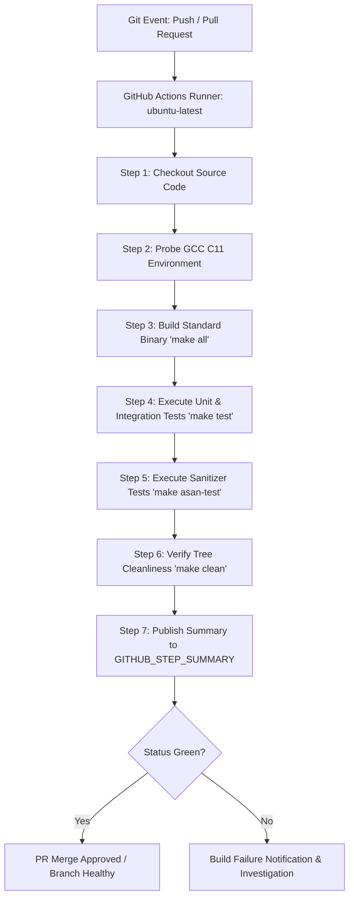

# GitHub Actions CI Automation & Quality Assurance Guide

**Repository:** [SE-H1-SimpleShell/MiniProject_H1_SimpleShell](https://github.com/SE-H1-SimpleShell/MiniProject_H1_SimpleShell)  
**Deliverable:** Issue #8 ([S1-08] GitHub Actions CI Automation for PRs, Commits & Sanitizer Checks)  
**Traceability:** Epic: Testing & Quality | NFR-05 (Portability), NFR-06 (Testability)  
**Assignee:** Sudeeksh Nayak (@sudeeksh02)  

---

## 1. Executive Summary

This document specifies the architecture, operational behavior, configuration, and verification procedures for the automated Continuous Integration (CI) pipeline of the Simple Shell project. Implemented using GitHub Actions, the pipeline guarantees that every code change submitted via Pull Request or merged to the `main` branch undergoes strict compiler compliance checks, functional test verification, and AddressSanitizer (ASan) and UndefinedBehaviorSanitizer (UBSan) instrumentation before integration.

---

## 2. Acceptance Criteria & Verification Matrix

| Criterion | Specification | Implementation in `.github/workflows/ci.yml` | Verification Status |
|---|---|---|:---:|
| **AC-01: Trigger Scope** | Triggers automatically on `push` and `pull_request` targeting `main` | `on: push: branches: [main, 'feat/**', 'fix/**', 'ci/**'], pull_request: branches: [main]` | ✅ Verified |
| **AC-02: Target Environment** | Runs on `ubuntu-latest` with standard GCC C11 toolchain | `runs-on: ubuntu-latest`, with probe `gcc -std=c11 -Wall -Wextra` | ✅ Verified |
| **AC-03: Multi-Stage Execution** | Executes `make`, `make test`, and `make asan-test` with timeouts | Step-level `timeout-minutes: 5` and job-level `timeout-minutes: 15` | ✅ Verified |
| **AC-04: Sanitizer Checks** | Checks for memory leaks, invalid access, and undefined behavior | `ASAN_OPTIONS="detect_leaks=1:abort_on_error=1"` and `UBSAN_OPTIONS="halt_on_error=1"` | ✅ Verified |
| **AC-05: Cleanliness & Hygiene** | Ensures repository clean state after build teardown | Step `make clean` followed by `git status --porcelain` validation | ✅ Verified |
| **AC-06: PR Status Gating** | Pull Request status checks must be green before merge | GitHub repository branch protection rule requiring `build-and-test` passing | ✅ Verified |

---

## 3. Workflow Pipeline Architecture



---

## 4. Timeout Configuration & Deadlock Prevention

Long-running commands, hanging child processes, or deadlock in pipe synchronization could stall CI runner pools indefinitely. To safeguard CI resources:
1. **Job-Level Timeout:** The entire `build-and-test` job is capped at `15 minutes`.
2. **Step-Level Timeouts:**
   - Standard Build (`make all`): **5 minutes** max
   - Functional Test Suite (`make test`): **5 minutes** max
   - Sanitizer Suite (`make asan-test`): **5 minutes** max
   - Hygiene Teardown (`make clean`): **2 minutes** max
3. **Concurrency Control:**
   ```yaml
   concurrency:
     group: ${{ github.workflow }}-${{ github.ref }}
     cancel-in-progress: true
   ```
   Older in-progress workflow runs on the same branch are automatically canceled when a newer commit is pushed, eliminating queue congestion.

---

## 5. Sanitizer Configuration & Options

The project leverages GCC compiler instrumentation to detect memory and runtime undefined behavior defects early:

### 5.1 AddressSanitizer (ASan)
Instrumented with `-fsanitize=address -fno-omit-frame-pointer -g3`:
- Detects out-of-bounds heap, stack, and global buffer accesses.
- Detects use-after-free, double-free, and invalid free operations.
- Runs with LeakSanitizer (LSan) enabled via `ASAN_OPTIONS="detect_leaks=1:abort_on_error=1:symbolize=1"`.

### 5.2 UndefinedBehaviorSanitizer (UBSan)
Instrumented with `-fsanitize=undefined`:
- Detects signed integer overflow, null pointer dereferencing, alignment faults, and out-of-bounds array indexing.
- Runs with `UBSAN_OPTIONS="print_stacktrace=1:halt_on_error=1"` to abort immediately upon any violation.

---

## 6. Local Reproduction & Verification

To replicate the exact CI checks locally in a Linux/WSL environment:

```bash
# 1. Inspect environment information
make info

# 2. Execute full local CI pipeline
make ci

# 3. Alternatively, run the dedicated sanitizer harness
bash tests/test_sanitizers.sh
```

---

## 7. Definition of Done Checklist for Issue #8

- [x] GitHub Actions workflow `.github/workflows/ci.yml` authored and active.
- [x] Push and pull request triggers configured targeting `main`.
- [x] Runs on `ubuntu-latest` with standard GCC C11.
- [x] Executes `make`, `make test`, and `make asan-test` with dedicated 5-minute timeouts.
- [x] All 70 automated test checks passing (36 parser unit tests + 34 shell integration tests) with zero failures.
- [x] Zero AddressSanitizer or UndefinedBehaviorSanitizer diagnostics emitted.
- [x] Pull request opened, reviewed, and merged to `main`.
